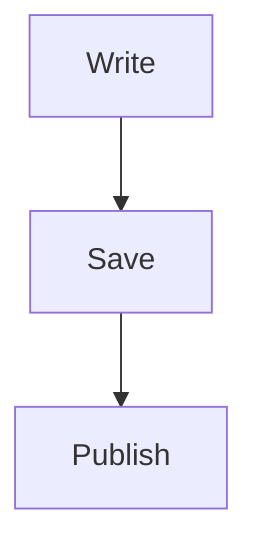

# Heading one

## Heading two

### Heading three

#### Heading four

A paragraph with `inline code`, **bold**, *italic* and a [link to the docs](https://tina.io/docs).

> A quote that says something worth quoting, long enough to wrap on a phone.

* Bulleted one
* Bulleted two

Tasks:

* [x] Done task
* [ ] Open task

---

```ts
const answer: number = 42;
console.log(answer);
```



<div class="note">Raw HTML block</div>

| Name | Role |
| --- | --- |
| Priya | Editor |
| Josh | Developer |

Closing paragraph.
